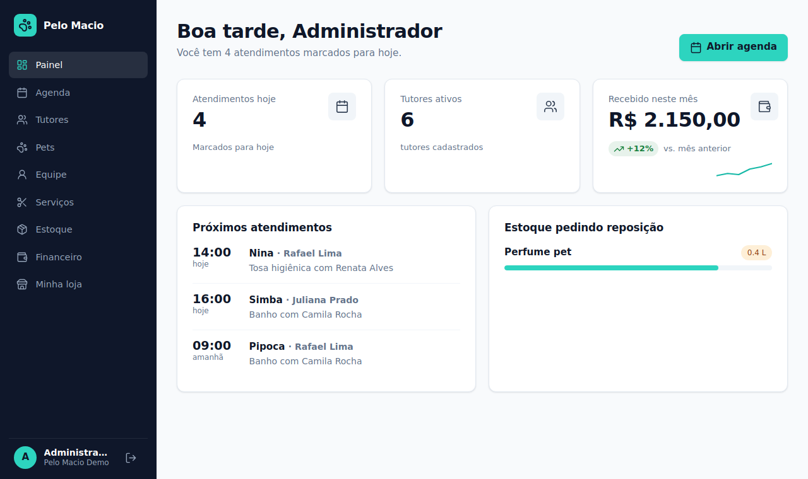
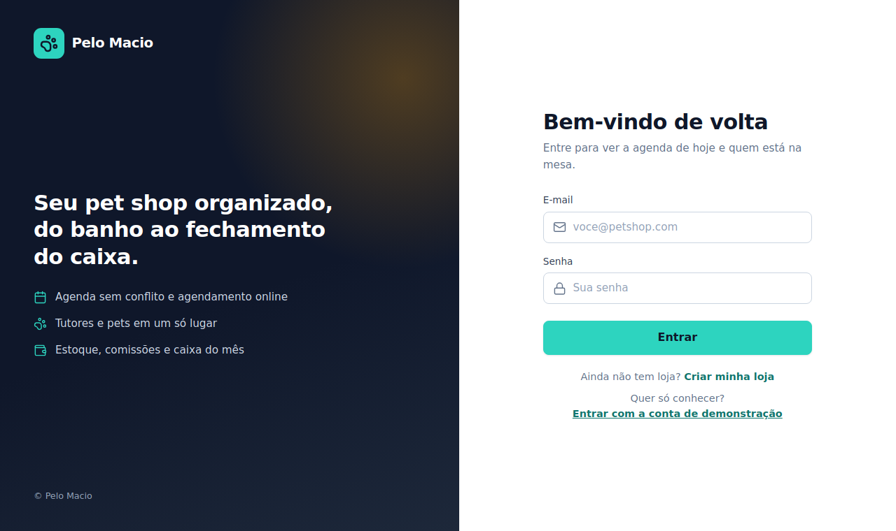
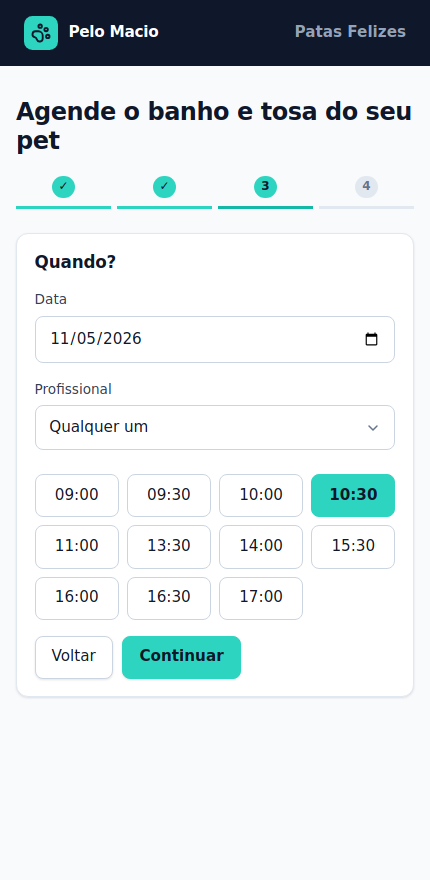
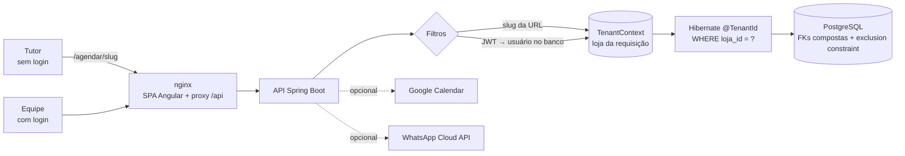

<p align="center">
  
</p>

<h1 align="center">Pelo Macio</h1>

<p align="center">
  Gestão multi-loja para pet shops: agenda de banho e tosa, tutores e pets, estoque, caixa
  e uma <strong>página pública para o tutor agendar sozinho</strong>.
</p>

<p align="center">
  
</p>

## O que tem de especial

- **Multi-loja de verdade.** Várias lojas na mesma instalação, cada uma isolada das outras. O isolamento é garantido em três camadas (aplicação, repositórios e banco) e tem teste de integração. Veja [Decisões de arquitetura](#decisões-de-arquitetura).
- **Página pública de agendamento** (`/agendar/{loja}`): o tutor escolhe o pet, o serviço e um horário livre, sem login. Preço e duração mudam com o porte do pet.
- **Sem horários sobrepostos, garantido pelo banco.** A aplicação checa e dá uma mensagem amigável; uma *exclusion constraint* do PostgreSQL fecha a corrida entre duas reservas simultâneas.
- **Onboarding.** `/cadastro` cria a loja, o administrador, um profissional e três serviços de exemplo, já prontos para receber agendamentos.
- Estoque com baixa automática por serviço, comissões, caixa com variação mensal, lembretes por WhatsApp e sincronização opcional com o Google Agenda de cada profissional.

| Login | Agendamento público |
|---|---|
|  |  |

## Como rodar

Precisa só de Docker.

```bash
docker compose up --build
```

Abra http://localhost:8081. O compose sobe PostgreSQL, API e frontend (nginx) e, por padrão, cria **duas lojas de demonstração**:

| Loja | Login | Senha | Página pública |
|---|---|---|---|
| Pelo Macio Demo | `demo@pelomacio.app` | `demo1234` | http://localhost:8081/agendar/demo |
| Patas Felizes | `patas@pelomacio.app` | `demo1234` | http://localhost:8081/agendar/patas-felizes |

Entre em uma, cadastre um tutor, depois entre na outra e confirme que ele não aparece. Para criar uma loja nova, use **Criar minha loja** na tela de login.

Em produção: copie `.env.example` para `.env`, defina `PELOMACIO_JWT_SECRET` e `DB_PASSWORD`, use `PELOMACIO_DEMO=false` e `DEMO.ativo = false` em `frontend/src/app/core/demo.ts`.

### Desenvolvimento local

```bash
# banco
docker run -d --name pelomacio-db -p 5432:5432 -e POSTGRES_DB=pelo_macio \
  -e POSTGRES_USER=pelomacio -e POSTGRES_PASSWORD=pelomacio postgres:16-alpine

# backend (Java 17, porta 8080); PELOMACIO_DEMO=true cria as lojas de exemplo
cd backend && PELOMACIO_DEMO=true mvn spring-boot:run

# frontend (porta 4200, com proxy para /api)
cd frontend && npm install && npm start
```

### Testes

```bash
# banco só para os testes de integração
docker run -d --name pelomacio-test-db -p 5433:5432 -e POSTGRES_PASSWORD=postgres \
  -e POSTGRES_DB=pelo_macio_test postgres:16-alpine

cd backend && mvn verify
```

Sem o banco acessível, os testes de integração são pulados (no CI, `CI=true` faz a ausência do banco falhar o build). O workflow em `.github/workflows/ci.yml` roda os testes, compila o frontend e sobe o `docker compose` para conferir a página pública de ponta a ponta.

## Arquitetura



- **Frontend:** Angular 19 (componentes standalone, signals), sem biblioteca de UI.
- **Backend:** Spring Boot 3.3 (Java 17), Spring Security com JWT, Spring Data JPA, Flyway.
- **Banco:** PostgreSQL 16.

## Decisões de arquitetura

### Multi-loja: coluna `loja_id` + filtro automático, em três camadas

Alternativas consideradas: um banco por loja (isolamento máximo, mas migrações e conexões multiplicam), um schema por loja (meio-termo, mesma dor operacional) e uma coluna discriminadora (um banco, uma migração). Escolhi a coluna porque o produto tem muitas lojas pequenas; o risco dela é esquecer um `WHERE`, e por isso o filtro não é manual:

1. **Aplicação.** As entidades de negócio têm `@TenantId` (Hibernate): toda consulta ganha `loja_id = ?` e todo `INSERT` grava a loja da sessão. A loja vem do `TenantContext`, preenchido por filtros: no login, a partir do **usuário carregado do banco** (nunca de um cabeçalho ou campo do token); na página pública, a partir do slug da URL. Rotas públicas ignoram o token, então um administrador logado numa loja que abre a página pública de outra continua vendo a outra.
2. **Repositórios.** `findById` do Spring Data usa `EntityManager.find`, e `find` não é garantido de passar pelo filtro. Por isso cada repositório de negócio redeclara `findById` como consulta JPQL, que sempre é filtrada. Relações que chegam por JSON (`{"cliente": {"id": 7}}`) são recarregadas por esses repositórios antes de gravar, então não dá para apontar para um registro de outra loja.
3. **Banco.** As chaves estrangeiras entre tabelas de negócio são **compostas** `(id, loja_id)`. Se um bug ligasse um pet da loja A a um tutor da loja B, o PostgreSQL recusa.

O teste `MultiLojaIntegrationTest` tenta ler, alterar, excluir e referenciar dados de outra loja pela API (esperando 404) e tenta violar as FKs compostas direto no banco.

Usuários são **globais**: o e-mail identifica a conta e aponta para a loja dela, o que permite o login sem pedir a loja. Por isso `Usuario` não usa o filtro automático e o `UsuarioService` filtra explicitamente.

### Como evita conflito de horário

Checar "há conflito?" e depois gravar não é atômico: dois tutores confirmando o mesmo horário ao mesmo tempo passariam na checagem. Então são duas defesas:

- **Aplicação:** `AgendamentoService` consulta conflitos (e o Google Agenda do profissional) e responde com uma mensagem clara.
- **Banco:** `EXCLUDE USING gist (profissional_id WITH =, tsrange(inicio, fim) WITH &&)`, ignorando cancelados, faltas e encaixes. Quem perde a corrida recebe `409 Esse horário acabou de ser ocupado`, e a página pública volta para a escolha de horário. Horários colados (um termina quando o outro começa) são permitidos porque o intervalo é aberto no fim.

### Autenticação

JWT sem estado, com expiração. Mesmo assim, **o usuário é recarregado do banco a cada requisição**: desativar uma conta ou mudar seus perfis vale imediatamente, e é daí que sai a loja. O custo é uma consulta por requisição, aceitável nesta escala. Senhas com BCrypt. Login e rotas públicas de escrita têm limite de requisições por IP.

### Tokens do Google

O `refresh_token` de cada profissional é guardado cifrado com AES-256-GCM (`TokenCipher`) e nunca sai pela API. A chave vem de `PELOMACIO_TOKEN_KEY` (ou é derivada do segredo do JWT). O callback do OAuth chega sem login, então o parâmetro `state` é um JWT assinado, de curta duração, com o profissional **e a loja**: é assim que o callback sabe em qual loja gravar.

### Página pública: o que ela expõe

Só serviços ativos, nomes de profissionais e horários livres. A reserva devolve apenas uma confirmação: nada do cadastro do tutor (o telefone identifica o tutor e não pode servir para consultar a base), e o cadastro existente nunca é alterado por essa rota.

## API (resumo)

| Rota | Acesso | Descrição |
|---|---|---|
| `POST /api/auth/login` | pública | Login; devolve token e a loja |
| `POST /api/publico/cadastro` | pública | Cria loja + administrador |
| `GET /api/publico/lojas/{slug}` e `/servicos`, `/profissionais` | pública | Dados da página de agendamento |
| `GET /api/publico/lojas/{slug}/horarios?servicoId&porte&data[&profissionalId]` | pública | Horários livres |
| `POST /api/publico/lojas/{slug}/agendamentos` | pública | Reserva do tutor |
| `/api/clientes`, `/api/pets`, `/api/servicos`, `/api/produtos`, `/api/profissionais` | equipe | CRUD (escrita em serviços, produtos e profissionais: só administrador) |
| `/api/agendamentos` | equipe | Agenda, mudança de status (concluir gera receita, comissão e baixa de estoque) |
| `GET/PUT /api/loja` | admin | Horário de funcionamento e agendamento online |
| `/api/financeiro`, `/api/usuarios` | admin | Caixa e usuários da loja |

## Limitações conhecidas

- O limitador de requisições é em memória, por instância; com várias réplicas o certo é limitar no proxy ou em um Redis.
- As credenciais do WhatsApp são globais (uma por instalação), não por loja.
- O tutor é encontrado pelo telefone **exatamente como digitado** (só dígitos); cadastros feitos pela equipe com máscara podem gerar um segundo registro para o mesmo tutor.
- A lista de horários da página pública não consulta o Google Agenda (seria uma chamada externa por horário); a confirmação consulta, e pode recusar com mensagem.
- Não há remarcação ou cancelamento pelo tutor (ele fala com a loja) nem portal do tutor.
- Os prints em `docs/img` são renderizações da interface com a folha de estilos real; troque pelos capturados do app rodando.

## Integrações opcionais

**WhatsApp:** defina `WHATSAPP_TOKEN` e `WHATSAPP_PHONE_ID` (Cloud API). Sem eles, as mensagens aparecem só no log. Um job diário envia o lembrete de amanhã, loja por loja.

**Google Agenda:** crie um cliente OAuth no Google Cloud (tipo "Aplicativo da Web"), habilite a Calendar API, cadastre `GOOGLE_REDIRECT_URI` (por padrão `http://localhost:8081/api/google/callback`) e defina `GOOGLE_CLIENT_ID` e `GOOGLE_CLIENT_SECRET`. Cada profissional conecta a própria conta em **Google Agenda**.

## Estrutura

```
backend/   Spring Boot: model, repository, service, controller, security (filtros e JWT), tenant, integration
frontend/  Angular: pages (agenda, agendar, loja, ...), shared (CRUD genérico, ícones), core
.github/   CI
```
